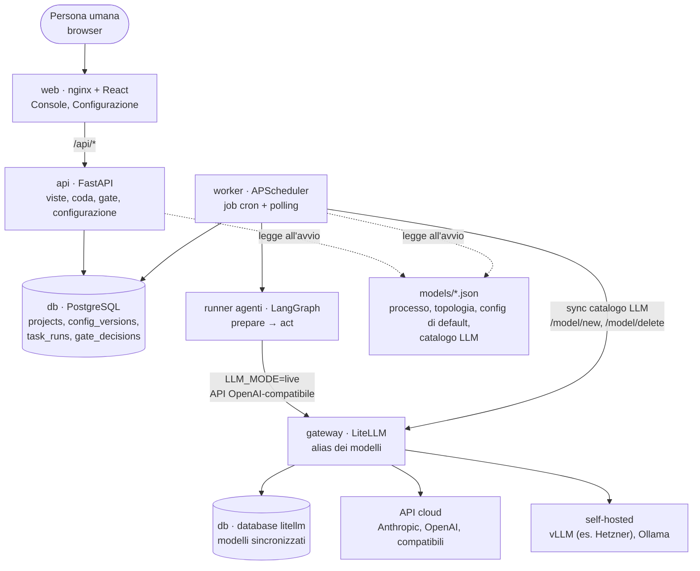
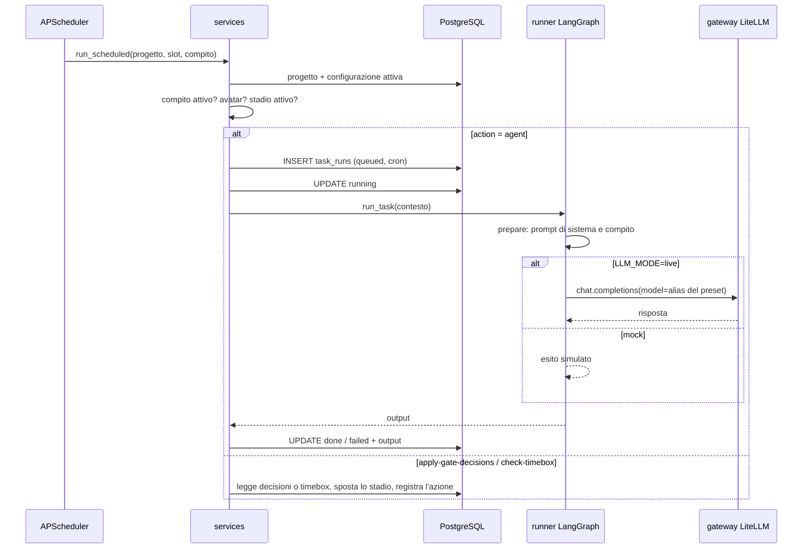
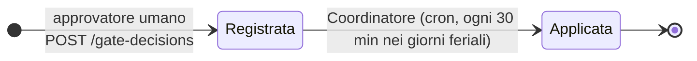

# Architettura

Questa pagina descrive l'architettura **implementata nel repository** (fase 0 della roadmap). Il documento di analisi dello stack e delle licenze è esterno: [Ananke – Architettura e stack tecnologico](https://claude.ai/code/artifact/bb067dc7-a8bf-4bdc-8a6a-71212781bc61). Le decisioni sono in [decisioni.md](decisioni.md), il formato dei modelli in [modello-dati.md](modello-dati.md), le fasi successive in [roadmap.md](roadmap.md).

## 1. Principi

1. **I modelli JSON sono la fonte di verità.** Processo, topologia degli agenti e configurazione stanno in `models/`. Il codice li interpreta senza cablare stadi, ruoli o compiti.
2. **Solo cron e polling.** Non ci sono eventi, code di messaggi né webhook in ingresso. Ogni azione degli agenti parte da un job pianificato. Le azioni umane, cioè «Esegui ora» e le decisioni sui gate, si registrano nel database e vengono lette a intervalli.
3. **Responsabilità finale umana.** Chi approva un gate o è Accountable deve essere una persona umana. Chi revisiona usa una famiglia di modelli diversa da chi produce. Le regole sono in `backend/app/validation.py` e bloccano sia l'avvio sia il salvataggio della configurazione.
4. **Gateway unico verso i modelli.** Gli agenti chiamano solo il gateway LiteLLM, con gli alias dei preset, e mai gli SDK dei provider. I modelli del gateway non si scrivono a mano: il worker li sincronizza dal catalogo LLM di piattaforma, e le chiavi restano nelle variabili d'ambiente del gateway.
5. **La modalità mock funziona sempre.** Lo stack parte senza chiavi API e gli agenti producono un esito simulato.

## 2. Vista d'insieme



`api` e `worker` sono due processi distinti costruiti dalla stessa immagine. Condividono il codice di `backend/app/` e comunicano **solo attraverso il database**, senza chiamate dirette tra loro.

## 3. Servizi Docker

| Servizio | Immagine | Profilo | Ruolo |
| --- | --- | --- | --- |
| `db` | `postgres:17-alpine` | sempre | Stato persistente (volume `pgdata`) |
| `api` | build di `backend/Dockerfile` | sempre | API HTTP su `:8000`, valida i modelli all'avvio |
| `worker` | stessa immagine, `python -m app.worker` | sempre | Scheduler cron ed esecuzione degli agenti |
| `web` | build di `frontend/Dockerfile` (nginx) | sempre | SPA su `:8080`, proxy di `/api/` verso `api:8000` |
| `gateway-db-init` | `postgres:17-alpine` | `live` | Esecuzione singola: crea il database `litellm` sullo stesso Postgres, se manca |
| `gateway` | `ghcr.io/berriai/litellm:main-stable` | `live` | Proxy verso i modelli. I modelli stanno nel database `litellm` e li sincronizza il worker. Le chiavi arrivano dal file `.env` (`env_file`) |
| `ollama` | `ollama/ollama` | `local-llm` | Modelli open in locale (volume `ollama`) |

Ordine di avvio: `db` sano → `api` sana (healthcheck su `/api/health`) → `worker` e `web`. L'immagine del backend contiene già `models/` e `data/`, quindi un cambio dei modelli richiede una nuova build. Le CA aziendali si iniettano dal contesto di build `certs/` (vedi `certs/README.md`).

### Variabili d'ambiente principali

| Variabile | Default | Effetto |
| --- | --- | --- |
| `DATABASE_URL` | SQLite `./dev.db` fuori da Docker | Connessione SQLAlchemy async (`asyncpg` in Docker) |
| `LLM_MODE` | `mock` | `live` attiva le chiamate al gateway |
| `LLM_BASE_URL` / `LLM_API_KEY` | `http://gateway:4000/v1` / master key LiteLLM | Endpoint e chiave usati dal runner |
| `LLM_ADMIN_URL` | `http://gateway:4000` | API di gestione modelli del gateway, usata dal worker per la sincronizzazione |
| `LITELLM_SALT_KEY` | valore di sviluppo | Cifra le credenziali nel database del gateway; non va cambiata dopo il primo avvio |
| Chiavi dei provider (`ANTHROPIC_API_KEY`, `OPENAI_API_KEY`, `HETZNER_LLM_API_KEY`, …) | vuote | Lette solo dal gateway; i nomi sono quelli indicati nel catalogo LLM |
| `APP_TIMEZONE` | `Europe/Rome` | Fuso dei cron e del calcolo delle prossime esecuzioni |
| `WORKER_POLL_SECONDS` | `30` | Intervallo di lettura delle richieste «Esegui ora» |
| `WORKER_RELOAD_MINUTES` | `5` | Intervallo di ricaricamento della configurazione e ripianificazione |
| `MODELS_DIR` / `DATA_DIR` | `models/` e `data/` del repository | Posizione dei modelli e del seed dei progetti |

## 4. Modelli: la fonte di verità

Per ogni metodologia (`waterfall`, `scrum`) ci sono tre documenti, validati dagli schemi JSON in `models/schemas/` (processo e topologia v1.1, configurazione v1.2). A questi si aggiunge un documento di piattaforma, condiviso da tutte le metodologie: il catalogo LLM.

| Documento | Domanda | Contenuto |
| --- | --- | --- |
| `*.process.json` | **Cosa** succede | Ruoli, artefatti, stadi con attività e RACI, gate con criteri e approvatori, transizioni, processi trasversali |
| `*.agents.json` | **Quali slot** lo fanno | Supervisore (PM Office o Agile Office) con i suoi agenti, un orchestratore per stadio con agenti specialisti, compiti pianificati (`scheduledTasks`), revisori, checkpoint umani |
| `*.config.json` | **Con chi e con cosa** | Persone (umani e avatar), assegnazione di ruoli e slot, preset degli agenti (modello, modello di riserva, temperatura), connettori, binding degli artefatti, policy |
| `platform/llm-catalog.json` | **Su quali modelli** | Provider (cloud o self-hosted, indirizzo, nome della variabile con la chiave) e modelli con alias, id presso il provider e famiglia. È la fonte del gateway e delle famiglie usate dalla regola cross-family |

Dimensioni attuali:

| | Stadi | Ruoli | Slot agente | Persone |
| --- | --- | --- | --- | --- |
| Waterfall | 9 (initiation → closure), ognuno con gate | 8 | 9 nel PM Office + 34 negli orchestratori | 6 umani, 15 avatar |
| Scrum | 6 (product-backlog continuo; sprint-planning, sprint, review e retro a timebox; release) | 7 | 7 nell'Agile Office + 17 negli orchestratori | 5 umani, 11 avatar |

**Caricamento** (`catalog.py`). All'avvio `Catalog.load()` legge schemi e modelli, crea un `Bundle` per metodologia e carica il catalogo LLM di default (`cat.llm_catalog`). Il bundle espone viste indicizzate: `stages` (ordinati per `order`), `roles`, `agents` (tutti gli slot con lo stadio dell'orchestratore, `None` per il supervisore), `activity_stage` e `transitions_from()`. Il catalogo è in cache per processo (`services.catalog()`).

**Configurazione attiva.** La configurazione di default è quella del file `*.config.json` (versione 0). Ogni salvataggio dalla GUI crea una nuova riga in `config_versions`. `active_config()` restituisce sempre l'ultima versione salvata. Le versioni salvate con lo schema 1.1 vengono portate alla 1.2 in lettura (`upgrade_config`): si toglie `llmProviders` e si aggiornano i riferimenti dei preset.

Il catalogo LLM funziona allo stesso modo con `llm_catalog_versions` e `active_llm_catalog()`. Processo e topologia invece non sono modificabili da GUI: si cambiano solo nei file.

**Persone, slot e avatar.** Uno *slot* è una posizione della topologia (per esempio `requirements-writer-agent`). Ogni slot è assegnato a una *persona* del catalogo:

- se la persona è un **avatar**, lo slot gira sulla piattaforma con un preset LLM, istruzioni, autonomia e override dei compiti;
- se è un **umano**, i compiti dello slot diventano manuali, si svolgono fuori dalla piattaforma e non vengono pianificati.

Un avatar è l'insieme degli slot che gli sono assegnati. I *ruoli* del processo (Sponsor, PM, Product Owner…) si assegnano solo a persone umane, con modalità `human`, `hybrid` o `agent`.

## 5. Backend

```
backend/app/
  main.py         API FastAPI (rotte sottili)
  services.py     logica condivisa API/worker: configurazione attiva, coda, esecuzione, gate, timebox
  scheduling.py   compiti effettivi (topologia + override), stadio attivo, prossimo scatto, durate ISO 8601
  validation.py   schema + coerenza dei riferimenti + regole di governance
  views.py        viste per la console: stadi, RACI per persone, dettaglio persona, gate
  catalog.py      caricamento dei modelli
  db.py           tabelle SQLAlchemy Core, engine async, seed dei progetti
  settings.py     configurazione da variabili d'ambiente
  worker.py       scheduler APScheduler
  agents/runner.py  grafo LangGraph di esecuzione di un compito
```

Le tabelle usano SQLAlchemy 2 Core in modalità async, senza ORM. In produzione il driver è `asyncpg`, nei test `aiosqlite`.

### 5.1 Persistenza (`db.py`)

| Tabella | Contenuto | Note |
| --- | --- | --- |
| `projects` | id, nome, cliente, metodologia, `current_stage`, `stage_started_at`, `sprint` | Seed da `data/projects.json` al primo avvio, se la tabella è vuota |
| `config_versions` | metodologia, configurazione JSON completa, data | Solo inserimenti: l'ultima riga è quella attiva |
| `task_runs` | progetto, slot, compito, persona, `trigger` (`cron`/`manual`), `status` (`queued`/`running`/`done`/`failed`), output, timestamp | Storico di ogni esecuzione e delle azioni del Coordinatore |
| `gate_decisions` | progetto, stadio, esito (`approved`/`rejected`), destinazione, persona, nota, `applied_at` | `applied_at` vuoto = decisione registrata ma non ancora applicata |
| `llm_catalog_versions` | catalogo LLM completo, data | Solo inserimenti: l'ultima riga è quella attiva |
| `gateway_syncs` | versione del catalogo, esito (`ok`/`error`/`skipped`), dettaglio, ora dell'ultimo controllo | Una riga per esito diverso; se l'esito non cambia si aggiorna solo l'ora |

Lo schema si crea con `metadata.create_all` all'avvio di `api` e `worker`. Non ci sono migrazioni. I timestamp si salvano in UTC.

### 5.2 API (`main.py`)

All'avvio (`lifespan`) l'API valida processo e topologia di ogni metodologia. Se trova errori si rifiuta di partire.

| Metodo e percorso | Uso |
| --- | --- |
| `GET /api/health` | Stato, `LLM_MODE`, metodologie caricate |
| `GET /api/projects` | Elenco progetti con stadio corrente |
| `GET /api/projects/{pid}` | Dettaglio: stadi con stato (`done`, `active`, `future`, `continuous`) e gate corrente con criteri, approvatori e destinazioni |
| `GET /api/projects/{pid}/stages/{sid}/raci` | Matrice RACI dello stadio, espressa per **persone** anziché per ruoli |
| `GET /api/projects/{pid}/personas/{id}` | Dettaglio di una persona: ruoli, slot, compiti con cron e prossimo scatto, ultime 20 esecuzioni |
| `POST /api/projects/{pid}/runs` | «Esegui ora»: mette in coda un compito di un avatar (202) |
| `POST /api/projects/{pid}/gate-decisions` | Registra la decisione di un approvatore umano del gate corrente (201) |
| `GET /api/methodologies` | Metodologie disponibili |
| `GET /api/methodologies/{m}/model` | Processo e topologia, in sola lettura |
| `GET /api/methodologies/{m}/config` | Configurazione attiva e numero di versione |
| `POST /api/methodologies/{m}/config/validate` | Validazione senza salvataggio |
| `PUT /api/methodologies/{m}/config` | Validazione (con il catalogo LLM attivo) e salvataggio come nuova versione; 422 con l'elenco degli errori |
| `GET /api/llm/catalog` | Catalogo LLM attivo e numero di versione |
| `POST /api/llm/catalog/validate` | Validazione del catalogo e di tutte le configurazioni attive con quel catalogo |
| `PUT /api/llm/catalog` | Salvataggio come nuova versione; 422 se il catalogo non è valido o rende invalida una qualunque metodologia |
| `GET /api/llm/gateway-status` | Modalità, versione del catalogo, esito dell'ultima sincronizzazione del gateway |

### 5.3 Viste RACI (`views.py`)

La console ragiona per persone, non per ruoli. `raci_view` costruisce le colonne R, A, C e I in tre passi:

1. per ogni lettera prende i ruoli che compaiono nelle attività dello stadio e li traduce nelle persone umane assegnate. I ruoli in modalità `agent` vengono saltati;
2. aggiunge come **R** le persone, umane o avatar, che eseguono gli slot attivi nello stadio: gli slot del suo orchestratore e quelli del supervisore che coprono attività dello stadio;
3. toglie dalle colonne C e I chi è già in R o in A.

### 5.4 Validazione e governance (`validation.py`)

`validate_bundle` = `validate_process_and_topology` + `validate_config`, che riceve anche il catalogo LLM attivo. La stessa funzione è usata da quattro punti:

- l'avvio dell'API;
- `PUT /config`;
- `scripts/validate_models.py`;
- i test.

Controlli principali:

- **schema** JSON Draft 2020-12 di ciascun documento;
- **riferimenti** coerenti: ruoli, artefatti, stadi, attività, slot, preset, connettori, persone e compiti;
- **copertura**: ogni stadio ha un orchestratore, ogni attività è coperta da uno slot, ogni artefatto di output è prodotto da qualcuno, ogni processo trasversale ha un agente del supervisore, ogni artefatto ha un connettore di destinazione;
- **approvatori e Accountable umani**: i ruoli che approvano un gate o sono `A` in una RACI non possono essere in modalità `agent` e devono avere almeno una persona assegnata;
- **ruoli solo a umani**: un avatar non può essere titolare di un ruolo del processo;
- **avatar eseguibili**: uno slot assegnato a un avatar richiede un preset `llm-agent`;
- **cron validi**, sia nella topologia sia negli override;
- **connettori**: id unici; in `settings` nessun segreto in chiaro (chiavi come `token`, `password`, `apiKey` sono rifiutate), le chiavi `*Env` e la lista `envVars` contengono solo nomi di variabili d'ambiente, non riservate alla piattaforma;
- **email** in formato valido, se presente, sia per gli umani sia per gli avatar (utente tecnico);
- **revisione cross-family**: con `policy.crossFamilyReview` attiva, lo slot revisore (`reviewedBy`) non può usare la stessa famiglia di modelli dello slot revisionato. La famiglia si ricava dal catalogo LLM (`providers[].models[].family`) tramite il preset. Contano sia il modello principale sia quello di riserva (`fallbackModel`), perché il runner può passare all'altro. Gateway e validazione leggono la stessa fonte;
- **preset su modelli attivi**: `model` e `fallbackModel` devono indicare un modello attivo di un provider attivo del catalogo.

`validate_llm_catalog` controlla il catalogo:
- schema;
- provider unici;
- alias unici in tutta la piattaforma, perché sono i nomi dei modelli nel gateway;
- indirizzo obbligatorio per `openai-compatible`, `vllm` e `ollama`;
- variabile della chiave obbligatoria per `anthropic` e `openai`. Il nome deve finire con `_API_KEY`, `_KEY` o `_TOKEN` e non può iniziare con `LITELLM_`, `POSTGRES_`, `DATABASE_`, `LLM_` o `PG`: così un segreto della piattaforma non può essere inviato a un provider.

Un catalogo si salva solo se tutte le configurazioni attive restano valide (`validate_llm_catalog_change`). All'avvio l'API ripete il controllo e, se trova incoerenze (per esempio un file di catalogo cambiato con un deploy), le scrive nel log.

Queste regole non vanno indebolite (vedi `CLAUDE.md`, regola 2). Il sub-agente `governance-reviewer` le verifica prima di chiudere ogni fase.

### 5.5 Pianificazione (`scheduling.py`)

`effective_tasks(bundle, config)` unisce i `scheduledTasks` della topologia con la configurazione dello slot e produce un `EffectiveTask` per compito. Per ognuno ricava:

- persona e tipo (`avatar`/`human`);
- cron, eventualmente sovrascritto da `taskOverrides`;
- abilitazione, data dallo slot e dall'override;
- azione;
- stadio.

Le azioni possibili sono tre:

| `action` | Chi la esegue | Effetto |
| --- | --- | --- |
| `agent` (default) | runner LangGraph | Esecuzione LLM, registrata in `task_runs` |
| `apply-gate-decisions` | Coordinatore (`pm-lead-agent` / `agile-lead-agent`) | Applica le decisioni umane sui gate, senza LLM |
| `check-timebox` | Coordinatore Scrum | Chiude uno stadio a timebox scaduto, senza LLM |

`stage_is_active` stabilisce quando un compito gira:
- un compito di orchestratore gira solo se il suo stadio è quello corrente, oppure se lo stadio è `continuous` (product backlog);
- i compiti del supervisore girano sempre.

### 5.6 Worker (`worker.py`)

Un solo `AsyncIOScheduler` nel fuso `APP_TIMEZONE` gestisce tre famiglie di job:

1. **`task:{progetto}:{slot}:{compito}`**: un job cron per ogni compito abilitato di un avatar, per ogni progetto, con `misfire_grace_time=300`, `coalesce` e `max_instances=1`. Allo scatto chiama `services.run_scheduled`.
2. **`poll-manual-runs`** ogni `WORKER_POLL_SECONDS`: esegue fino a 20 `task_runs` in stato `queued`, cioè le richieste «Esegui ora».
3. **`reload`** ogni `WORKER_RELOAD_MINUTES`: rimuove e ricrea tutti i job `task:*` dalla configurazione attiva. Un cambio di configurazione diventa effettivo entro questo intervallo.
4. **`sync-gateway`** all'avvio e poi ogni `WORKER_RELOAD_MINUTES`: sincronizza il gateway con il catalogo LLM attivo (`gateway.py`). In modalità mock registra `skipped` senza chiamate.

### 5.7 Esecuzione degli agenti (`services.py` + `agents/runner.py`)



**Contesto passato all'agente** (`execute_run`): nome del progetto, nome dello stadio, avatar, nome dell'agente, responsabilità dello slot, autonomia, istruzioni dello slot, nome del compito, modello e temperatura del preset.

**Grafo LangGraph** (`runner.py`): `START → prepare → act → END`, con uno stato tipizzato `RunState` (`context`, `system`, `prompt`, `output`).

- `prepare` compone il prompt di sistema (identità, fase, responsabilità, autonomia, divieto di decisioni riservate agli approvatori) e la richiesta del compito.
- `act`:
  - in modalità **mock** restituisce un testo simulato;
  - in modalità **live** usa il client `openai.AsyncOpenAI` puntato su `LLM_BASE_URL`. Dal riferimento `provider/alias` del preset prende l'alias (per esempio `anthropic/claude-sonnet` → `claude-sonnet`), unico nel catalogo, e lo passa come `model` al gateway, con `max_tokens=1500`. Se la chiamata fallisce e il preset ha un `fallbackModel`, riprova su quel modello e lo segnala nell'output.

Il grafo è compilato una volta per processo. Non usa strumenti, cicli né checkpoint, e gli agenti non si scambiano messaggi: ogni esecuzione è un compito singolo e indipendente. Un'eccezione dell'agente marca il run come `failed` con il messaggio d'errore, e il worker continua.

### 5.8 Gate e timebox



1. Dalla console un approvatore umano del gate corrente registra `approved` o `rejected`, con un'eventuale destinazione tra quelle ammesse dalle transizioni `gate_approved`. L'API verifica che la persona sia tra gli approvatori.
2. Il compito `apply-gate-decisions` del Coordinatore legge le decisioni non applicate dello stadio corrente e usa **l'ultima**:
   - **approvata**: sposta il progetto sulla destinazione scelta, oppure sulla prima transizione `gate_approved`;
   - **respinta**: lo stadio resta attivo per il rework.

   Marca poi tutte le decisioni lette come applicate e registra l'azione in `task_runs`.
3. Il compito `check-timebox` (Scrum, ogni 15 minuti) confronta `stage_started_at` con il `timebox` ISO 8601 dello stadio. Allo scadere applica la transizione `timebox_end`.
4. Dopo ogni passaggio di stadio si aggiorna `stage_started_at`. Nel passaggio da retrospettiva a sprint planning si incrementa anche `sprint`.

### 5.9 Gateway dei modelli e catalogo LLM

Il file `gateway/litellm.config.yaml` non contiene modelli: imposta solo la master key, il database (`database_url`) e `store_model_in_db`. I modelli arrivano dal catalogo LLM tramite `app/gateway.py`:

- `litellm_params` traduce ogni modello del catalogo nei parametri LiteLLM:

  | Tipo | Modello LiteLLM | Indirizzo |
  | --- | --- | --- |
  | `anthropic` | `anthropic/<id>` | — |
  | `openai` | `openai/<id>` | — |
  | `openai-compatible` | `openai/<id>` | `api_base` |
  | `vllm` | `hosted_vllm/<id>` | `api_base` |
  | `ollama` | `ollama_chat/<id>` | `api_base` |

  La chiave è sempre un riferimento `os.environ/<apiKeyEnv>`: il valore non passa mai da Ananke.
- `plan_sync` confronta i modelli voluti con `GET /model/info`:
  - i modelli pubblicati da Ananke hanno `model_info.ananke_managed` e un hash dei parametri;
  - un modello cambiato si rimuove e si ripubblica, uno tolto dal catalogo si rimuove;
  - i modelli definiti nel file del gateway non si toccano.
- `sync_gateway` applica il piano con `/model/delete` e `/model/new` (master key, `httpx`) e registra l'esito in `gateway_syncs`.

Catalogo di default:
- **Claude** (`claude-opus`, `claude-sonnet`, `claude-haiku`) e **Ollama locale**, attivi. Tutti gli alias `oss-*` usano oggi Qwen3.6 35B-A3B, famiglia `qwen`;
- **OpenAI**, **server GPU Hetzner con vLLM** e un **provider cloud OpenAI-compatibile**, presenti come esempi disattivati.

I fallback non stanno più nel router del gateway ma nel `fallbackModel` dei preset, gestito dal runner. Si usano solo funzioni del core MIT di LiteLLM.

## 6. Frontend

React 19 + TypeScript + Vite, senza librerie UI né router. In produzione è servito da nginx, che inoltra `/api/` all'API. In sviluppo c'è il proxy di Vite verso `:8000`. L'aspetto e i flussi devono restare coerenti con il mockup in `docs/mockup/`.

| File | Contenuto |
| --- | --- |
| `App.tsx` | Barra superiore con `LLM_MODE` corrente, navigazione Console/Configurazione |
| `pages/Console.tsx` | Scelta del progetto, macchina a stati degli stadi, RACI per persone dello stadio scelto, pannello della persona (slot, compiti, prossimo scatto, «Esegui ora», ultime esecuzioni), decisione sul gate per gli approvatori |
| `pages/LlmCatalogEditor.tsx` | Editor del catalogo LLM di piattaforma, con salvataggio e validazione propri. Provider con modelli già compilati (Claude, OpenAI, server proprio con vLLM come Hetzner, Ollama, API compatibile OpenAI), modelli con alias, id, famiglia e licenza, stato della sincronizzazione del gateway |
| `pages/Config.tsx` | Per metodologia, cinque schede: *Responsabili e agenti* (persona, preset, istruzioni, autonomia, abilitazione e cron dei compiti per slot), *Ruoli del processo* (modalità e persone umane), *Persone e avatar* (card con sfondo blu e bordo pieno per gli umani, verde e bordo tratteggiato per gli avatar; email per tutti), *Connettori* (in alto «Strumenti per fase»: connettore per funzione e destinazione degli artefatti raggruppati per la fase che li produce; sotto «Connettori»: elenco e popup modale di configurazione di ciascuno, con scelta tra connettore standard REST e server MCP remoto o locale e parametri specifici dello strumento da `frontend/src/connectorSpecs.ts`), *Modelli AI* (catalogo LLM condiviso e preset degli agenti della metodologia). La validazione avviene lato server prima del salvataggio |
| `api.ts`, `types.ts` | Client tipizzato delle API |
| `cron.ts` | Descrizione in italiano delle espressioni cron |
| `components/Avatar.tsx` | Volto delle persone |

## 7. Flussi end-to-end

| Flusso | Percorso | Latenza massima |
| --- | --- | --- |
| Compito pianificato | cron → `run_scheduled` → `execute_run` → runner | Allo scatto del cron |
| Esegui ora | Console → `POST /runs` (`queued`) → `poll-manual-runs` → `execute_run` | `WORKER_POLL_SECONDS` |
| Decisione sul gate | Console → `POST /gate-decisions` → compito del Coordinatore → cambio di stadio | Cron del Coordinatore (30 min, giorni feriali 8-19) |
| Chiusura timebox | `check-timebox` → transizione `timebox_end` | 15 min |
| Cambio di configurazione | Config → `PUT /config` (validata, nuova versione) → `reload` del worker | `WORKER_RELOAD_MINUTES`; le viste dell'API la usano subito |
| Cambio dei modelli AI | Modelli AI → `PUT /llm/catalog` (validato con tutte le metodologie) → `sync-gateway` del worker → API del gateway | `WORKER_RELOAD_MINUTES` |

## 8. Qualità e strumenti

- **Test** (`backend/tests/`): pytest + anyio su SQLite temporaneo con `LLM_MODE=mock`. `test_models.py` copre le regole di governance, `test_api.py` i flussi: RACI, esecuzione manuale, rifiuto dei compiti umani, gate applicato dal Coordinatore, timebox Scrum, validazione della configurazione.
- **Validazione dei modelli**: `python scripts/validate_models.py`.
- **Build frontend**: `npm run build` (typecheck + Vite).
- **Strumenti di Claude Code** in `.claude/`:
  - regole per area;
  - skill `licenza`, `nuovo-compito`, `valida-modelli`, `prossima-fase`;
  - sub-agenti `governance-reviewer` e `license-auditor`.
- **Licenze**: politica e inventario in [licenze.md](licenze.md).

## 9. Limiti noti e punti aperti

Lo scheletro esegue il ciclo completo. Diversi campi dei modelli però sono validati ma **non ancora usati a runtime**:

- `consumes`/`produces` e artefatti: gli agenti non ricevono né salvano artefatti. L'output resta testo in `task_runs` (fase 1).
- `reviewedBy`: la revisione cross-family è verificata nella configurazione, ma non viene eseguita (fase 1).
- `connectors`, `allowedConnectors`, `bindings`, `tools`: nessun client MCP nel runner (fase 2).
- `autonomy`: arriva all'agente solo come testo nel prompt e non limita alcuna azione (fase 2).
- `maxIterations` e `runtime` (`claude-agent-sdk`, `a2a`): ignorati dal runner.
- `humanCheckpoints` diversi dall'approvazione dei gate, come le change request di ambito o costi, non hanno un flusso.

Altri punti di attenzione:

- **Famiglie dichiarate.** Gateway e validazione leggono lo stesso catalogo, quindi l'alias porta sempre al modello dichiarato. La famiglia però resta una dichiarazione di chi configura: se indica una famiglia sbagliata, il controllo cross-family si fida.
- **Chiavi dei provider.** Una variabile aggiunta nel catalogo va scritta anche nel file `.env` e richiede il riavvio del gateway, che legge l'ambiente solo all'avvio. La GUI non può verificare che la variabile esista.
- **Database del gateway.** LiteLLM crea le sue tabelle nel database `litellm` dello stesso Postgres, quindi il backup di `pgdata` le include.
- **Concorrenza.** `execute_run` passa da `queued` a `running` senza lock di riga. In più un run creato dal cron è visibile come `queued` al polling prima di essere avviato. Con un solo worker la finestra è minima. Con più repliche del worker servirebbe un claim atomico, per esempio `UPDATE … WHERE status='queued'` controllando le righe aggiornate.
- **Decisioni multiple.** Se più approvatori registrano decisioni prima dell'esecuzione del Coordinatore, vale solo l'ultima. Le altre vengono marcate come applicate senza effetto.
- **Schema senza migrazioni** (`create_all`) e **nessuna autenticazione**: la console si fida del `personaId` inviato (fase 4).
- **Persistenza dei grafi LangGraph** e **osservabilità**: decisioni aperte, vedi [decisioni.md](decisioni.md).
